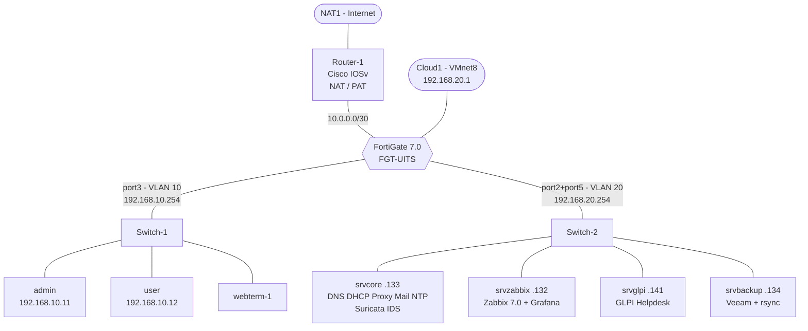

# UITS lab.lan : infrastructure sécurisée avec supervision, helpdesk et sauvegarde

Laboratoire d'entreprise virtualisé (stage professionnel, DUT Génie Informatique) : services réseau, sécurité multicouche,
supervision centralisée, gestion des incidents et sauvegarde, sur **GNS3 + VMware Workstation**.

> **Statut :** configurations reconstituées et documentées à partir du projet réalisé en laboratoire.
> Les fichiers sont des modèles prêts à appliquer ; chaque secret (mot de passe, jeton) est à fournir par variable d'environnement.

## Architecture



| Zone | Réseau | Passerelle | Machines |
|---|---|---|---|
| VLAN 10 Administration | 192.168.10.0/24 | FortiGate port3 (.254) | admin, user, webterm-1 |
| VLAN 20 Serveurs et sauvegarde | 192.168.20.0/24 | FortiGate lan20 (.254) | srvcore .133, srvzabbix .132, srvglpi .141, srvbackup .134 |
| Transit | 10.0.0.0/30 | Router-1 .1 / FortiGate .2 | |

## Services et outils

| Serveur | Rôle | Technologies |
|---|---|---|
| **srvcore** | Services réseau et détection d'intrusion | BIND9, ISC-DHCP, Squid, Postfix/Dovecot/Roundcube, Chrony, UFW, **Suricata IDS** |
| **srvzabbix** | Supervision | Zabbix 7.0 (MySQL, Apache), Grafana (plugin Zabbix), Prometheus + Node Exporter |
| **srvglpi** | Helpdesk | GLPI, API REST, tickets créés automatiquement depuis Zabbix |
| **srvbackup** | Sauvegarde | Veeam Agent for Linux, rsync + cron |
| **Périmètre** | Sécurité réseau | FortiGate 7.0 (politiques, NAT, relais DHCP), Cisco IOSv / IOSvL2 |

## Sécurité en couches

1. **Périmètre** : FortiGate, politiques au moindre privilège, VLAN admin isolé (les serveurs ne peuvent pas initier vers le VLAN admin).
2. **Hôte** : UFW restrictif sur chaque serveur.
3. **Détection** : Suricata IDS sur srvcore (≈ 50 000 règles Emerging Threats Open + règles locales), alertes sur un dashboard Flask et supervisées par Zabbix.
4. **Secrets** : aucun mot de passe ni jeton dans ce dépôt (variables d'environnement, fichiers `.env` ignorés par git).
5. **Traçabilité** : journalisation des politiques FortiGate et UFW, synchronisation NTP (Chrony).

## Contenu du dépôt

```
gns3/            configs Router-1, Switch-1/2, FortiGate, VPCS
srvcore/         réseau, DNS, DHCP, Squid, Postfix, Chrony, UFW, suricata/ (IDS + dashboard)
srvzabbix/       installation Zabbix, agent, glpi_alert.sh (intégration GLPI)
srvglpi/         installation GLPI
srvbackup/       backup-vms.sh (rsync) + cron, notes Veeam
docs/            ordre de déploiement, tests de validation, modèle de menaces et durcissement (securite.md)
scripts/         validate-lab.sh : tests de bout en bout (ICMP, DNS, ports UFW, web, blocage 9999)
.github/         CI : shellcheck, yamllint, validation des règles Suricata, détection de secrets (Gitleaks)
```

La CI s'exécute à chaque push ; `make lint` et `make validate` reproduisent les contrôles en local.

## Démarrage rapide

Voir [`docs/deploiement.md`](docs/deploiement.md) pour l'ordre complet. En résumé :

1. GNS3 : charger les configurations de `gns3/configs/` dans Router-1, Switch-1, Switch-2 et FortiGate, les fichiers `.vpc` dans les VPCS.
2. Chaque serveur : `netplan` statique, puis `ufw`, puis service (`install-*.sh`).
3. `srvcore/suricata/install-suricata.sh` puis `test-ids.sh`.

## Compétences mises en œuvre

Administration Linux (Ubuntu Server 24.04), réseaux (VLAN, NAT, routage, DHCP relay), pare-feu FortiGate et UFW,
détection d'intrusion Suricata, supervision Zabbix/Grafana, ITSM GLPI, automatisation Bash/Python, sauvegarde.
