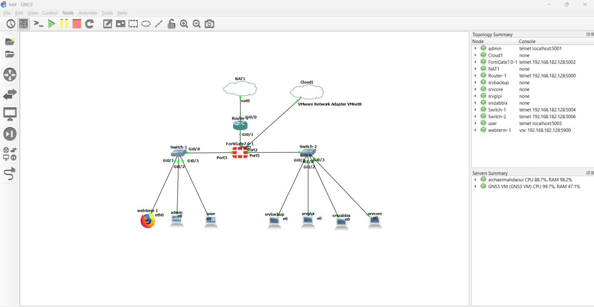
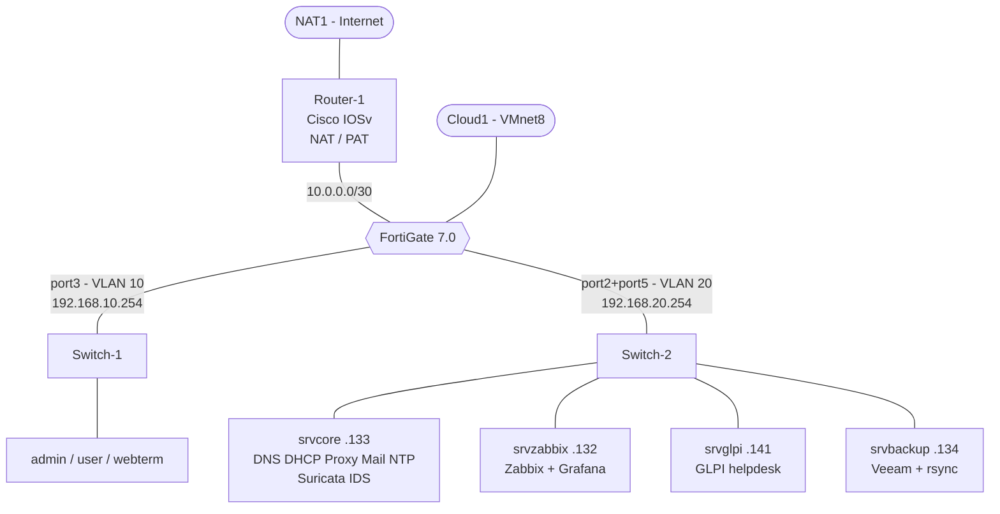
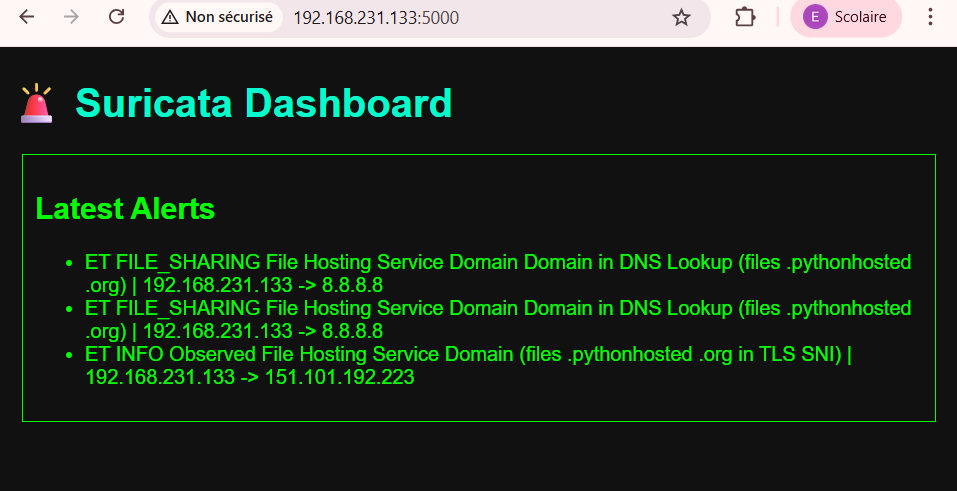
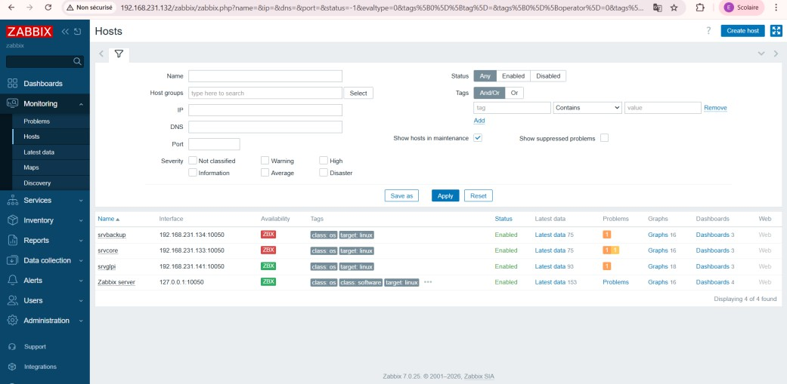
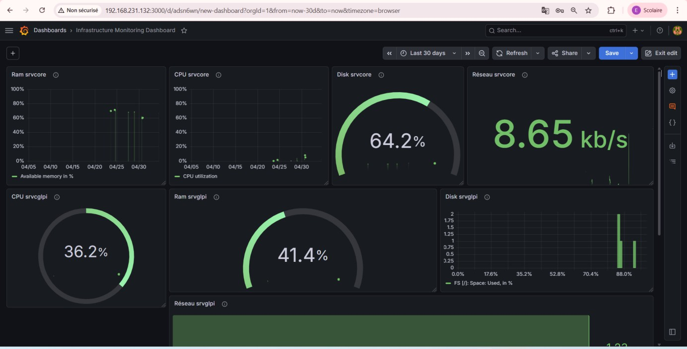
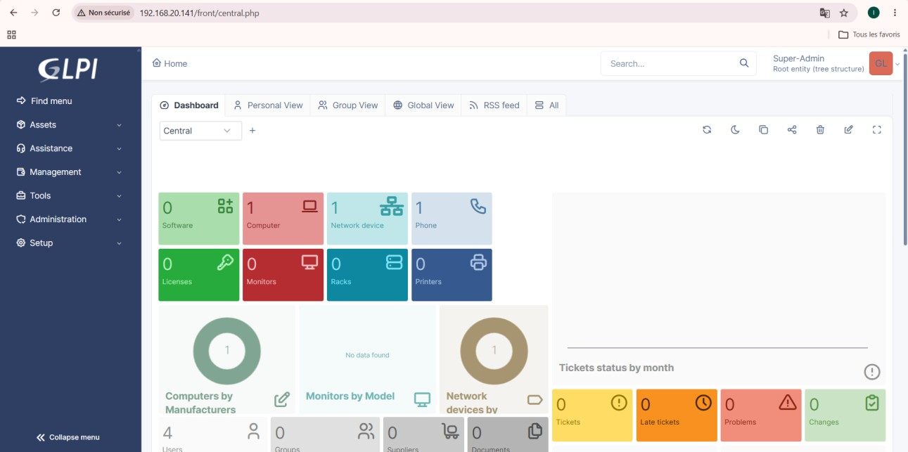
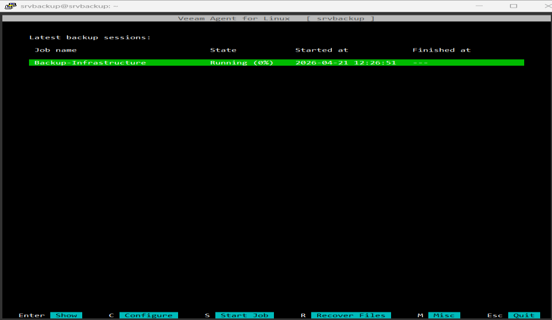

# UITS lab.lan: secured infrastructure with monitoring, helpdesk and backup

> 🇫🇷 [Version française](README.fr.md)

A virtualized enterprise lab built during my professional internship (DUT in Computer Engineering): core network services,
layered security, centralized monitoring, automated incident management and backup, on **GNS3 + VMware Workstation**.



**Stack:** Ubuntu Server 24.04 · FortiGate 7.0 · Cisco IOSv/IOSvL2 · BIND9 · ISC-DHCP · Squid · Postfix/Dovecot · Chrony · UFW ·
**Suricata IDS** · Zabbix 7.0 · Grafana · GLPI · Veeam Agent for Linux · Bash · Python (Flask)

> **Status:** the configuration files are templates reconstructed and cleaned from the lab I deployed (secrets removed,
> every password or token comes from an environment variable). The shell scripts pass `shellcheck` and the Suricata rules pass
> `suricata -T` in CI. Screenshots below come from the original lab.

## Architecture



| Zone | Network | Gateway | Hosts |
|---|---|---|---|
| VLAN 10 Administration | 192.168.10.0/24 | FortiGate port3 (.254) | admin, user, webterm-1 |
| VLAN 20 Servers & backup | 192.168.20.0/24 | FortiGate lan20 (.254) | srvcore .133, srvzabbix .132, srvglpi .141, srvbackup .134 |
| Transit | 10.0.0.0/30 | Router-1 .1 / FortiGate .2 | |

## What it does

| Server | Role | Highlights |
|---|---|---|
| **srvcore** | Network services + IDS | Authoritative DNS (forward + reverse), DHCP with relay for VLAN 10, Squid proxy, mail (Postfix/Dovecot/Roundcube), NTP, hardened UFW, **Suricata** |
| **srvzabbix** | Monitoring | Zabbix 7.0, agents on all servers, Grafana dashboards, alert → GLPI ticket automation |
| **srvglpi** | Helpdesk | GLPI with REST API; tickets created automatically from Zabbix alerts |
| **srvbackup** | Backup | Veeam Agent for Linux job + rsync/cron script over SSH keys, 7-day retention |

### Suricata IDS (srvcore)

- AF_PACKET capture on `ens33`, ~50 000 Emerging Threats Open rules + 5 local rules (SSH brute force, ICMP sweep, SYN port scan,
  Zabbix web access from a non-admin host, curl/wget from a server).
- Read-only Flask dashboard of the latest alerts (`eve.json`), exposed to the admin VLAN only, run by a hardened systemd unit.
- Monitored by Zabbix (`suricata.alerts.5m`), tested with `srvcore/suricata/test-ids.sh`.



## Security by layers

1. **Perimeter:** FortiGate least-privilege policies; servers cannot initiate connections to the admin VLAN (logged deny rule).
2. **Host:** restrictive UFW on every server (default deny incoming).
3. **Detection:** Suricata IDS with custom rules; alerts feed Zabbix and then GLPI.
4. **Secrets:** none in this repository (environment variables, `.env` files ignored by git, Gitleaks in CI).
5. **Traceability:** FortiGate and UFW logging, centralized NTP time source.

See [`docs/securite.md`](docs/securite.md) for the threat model, hardening checklist, known limits and roadmap.

## Evidence from the lab

| | |
|---|---|
|  |  |
| Zabbix: 4 monitored hosts | Grafana: CPU, RAM, disk, network |
|  |  |
| GLPI helpdesk | Veeam Agent for Linux: "Backup-Infrastructure" job |

> Screenshots come from the original lab (VMware NAT network 192.168.231.0/24). The files in this repository follow the addressing
> plan of the project report (192.168.20.0/24): adapt the IPs if your VMnet8 uses another subnet.

## Repository layout

```
gns3/            Router-1, Switch-1/2, FortiGate configs, VPCS files
srvcore/         network, DNS, DHCP, Squid, Postfix, Chrony, UFW, suricata/ (IDS + dashboard)
srvzabbix/       Zabbix install, agent, glpi_alert.sh (Zabbix -> GLPI integration)
srvglpi/         GLPI install
srvbackup/       backup-vms.sh (rsync) + cron
docs/            deployment order, threat model, CI workflow template, images
scripts/         validate-lab.sh: end-to-end checks (ICMP, DNS, UFW ports, web, blocked port)
```

## Quick start

See [`docs/deploiement.md`](docs/deploiement.md) (French) for the full order:

1. GNS3: paste `gns3/configs/*` into Router-1, Switch-1, Switch-2 and the FortiGate; `gns3/vpcs/*.vpc` into the VPCS nodes.
2. Each server: static `netplan`, then `ufw`, then its service (`install-*.sh`).
3. `sudo srvcore/suricata/install-suricata.sh`, then `srvcore/suricata/test-ids.sh`.
4. `./scripts/validate-lab.sh` from a lab host (`make validate`).

## Skills demonstrated

Linux administration · networking (VLAN, NAT, routing, DHCP relay) · FortiGate and UFW firewalling · intrusion detection (Suricata) ·
monitoring (Zabbix, Grafana) · ITSM (GLPI) · Bash and Python automation · backup strategy · CI with shellcheck, yamllint and Gitleaks.

## Author and license

Aicha El Mahdaoui, DUT in Computer Engineering. Released under the [MIT license](LICENSE).
